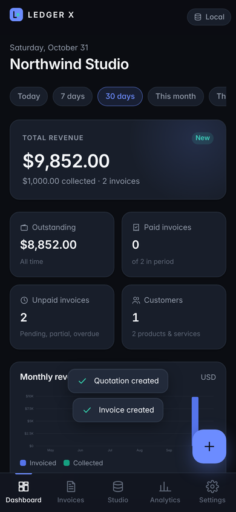
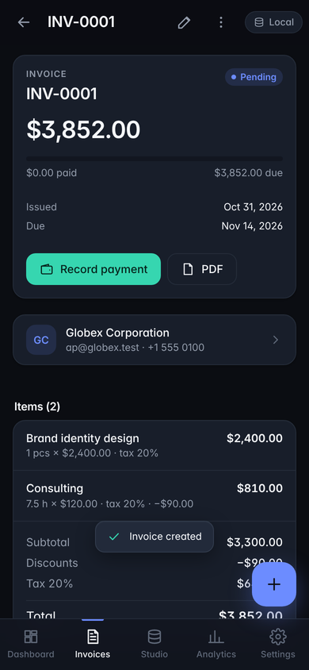
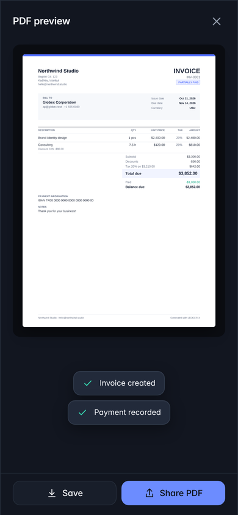
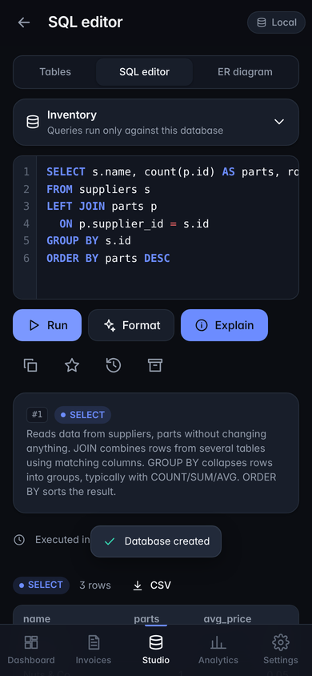
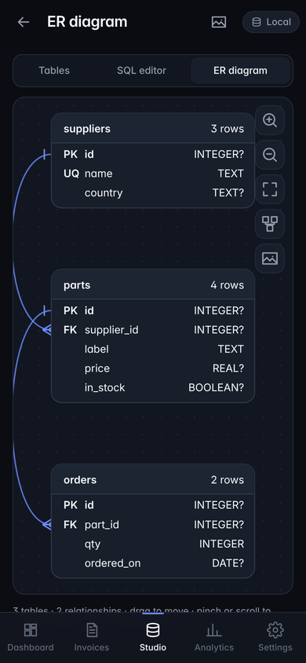

# LEDGER X

**Professional business management and a visual database studio, in one offline-first Android app.**

LEDGER X combines invoicing, quotations, customers, products and analytics with a full SQLite **Database Studio** (visual table designer, data grid, SQL editor and an interactive ER diagram). Data lives in SQLite on the device and works fully offline. When you connect your own Supabase project, LEDGER X syncs between devices, with conflict detection and field-level merging.

| Dashboard | Invoice | PDF | SQL editor | ER diagram |
|---|---|---|---|---|
|  |  |  |  |  |

## Download

Every push to `main` is built by GitHub Actions ([`.github/workflows/android.yml`](.github/workflows/android.yml)): tests run, the web bundle is built, the Capacitor Android project is generated and a debug APK is published under **[Releases → latest](../../releases/tag/latest)**. Pushing a tag like `v1.0.0` creates a versioned release.

To also get a **signed release APK**, add these repository secrets: `KEYSTORE_BASE64` (output of `base64 -w0 ledgerx-release.jks`), `KEYSTORE_PASSWORD`, `KEY_ALIAS`, `KEY_PASSWORD`. Optional `SUPABASE_URL` / `SUPABASE_ANON_KEY` secrets pre-fill the cloud settings.

---

## Features

**Business**
- Invoices: create, edit, duplicate, delete, search, filter, sort, PDF preview, save and share. Statuses are draft, pending, partially paid, paid, overdue and cancelled. Paid and overdue are derived automatically from payments and due dates.
- Quotations: expiry date, status tracking (draft, sent, accepted, rejected, expired), and one-tap **conversion to an invoice**. The quotation is kept, and the two records link to each other.
- Payments: partial payments, overpayment protection, and reversal. Invoices with payments can't be deleted (only cancelled), so financial history is preserved.
- Customers: profile, balance per currency, related invoices and quotations, and transaction history. Removing a customer who has documents **archives** them instead of deleting.
- Products and services: SKU, category, unit, price, tax, active flag, CSV export, and bulk price adjustment.
- Exact money: amounts are stored as integer minor units, quantities as thousandths and rates as basis points. All arithmetic uses BigInt with commercial rounding, so there is no floating point anywhere in the money path.
- Configurable tax rates: no country's rules are hard-coded, and every line carries its own rate. Tax is broken down per rate on screen and in the PDF.
- Analytics: revenue, collected, expenses (optional), net, outstanding, revenue over time, best customers and products, status distribution, and monthly comparison. Database analytics cover table sizes, growth, recently modified tables and a schema overview. Reports export to CSV.

**Database Studio**
- Every project is a **separate SQLite database**, isolated from business data. Business data can be browsed read-only.
- Visual table designer with all nine types (TEXT, INTEGER, REAL, NUMERIC, BOOLEAN, DATE, DATETIME, BLOB, JSON). You can set primary and composite keys, auto-increment, NOT NULL, UNIQUE, defaults and foreign keys with ON DELETE actions, plus indexes.
- Schema editing: rename tables, and add, edit or drop columns. Edits use SQLite's rebuild procedure with a foreign-key check, and drops are refused when unsafe (primary key, referenced columns).
- Data grid: typed add, edit and delete, search, column filters, sorting, pagination, and CSV import and export.
- SQL editor: syntax highlighting, line numbers, formatter, history, favorites, copy, timing, per-statement results and a plain-language **Explain** panel.
- ER diagram generated from the real schema (`PRAGMA table_info` / `foreign_key_list`). You can pan, pinch or wheel to zoom, drag tables (positions are saved), apply an automatic layout and export to PNG.
- Export a project as a portable `.sql` script, and import `.sql` scripts as new projects.

**Platform**
- Offline-first: every write is saved locally and queued in the same transaction.
- Supabase sync uses optimistic versioning, a 3-way merge and a conflict-resolution UI. Row Level Security is enforced.
- Backup and restore: one checksummed JSON file. Restores are validated before anything is written. Merge mode never overwrites existing records. Replace mode takes a safety backup first.
- Dark and light themes plus a system option (persisted), the Android back button, safe areas, the keyboard resize mode, and the share sheet.

---

## Quick start

Requires **Node.js 22.5+** (Node's built-in SQLite is used by the tests and dev server).

```bash
npm install
npm run build          # bundles src/ → dist/
npm test               # 55 unit/integration tests on real SQLite
npm run serve          # http://127.0.0.1:5173 — full app in a desktop browser
npm run e2e            # headless Chromium end-to-end run + screenshots
```

`npm run serve` runs the real app in your browser. Its SQLite statements go to on-disk files in `./.data` through a local-only bridge. On Android the app uses the native SQLite plugin instead. As a plain static web app it uses sql.js with IndexedDB persistence.

## Android

Prerequisites: Android Studio (Ladybug or newer), JDK 21 and Android SDK 35 (Capacitor 7). Run `npm outdated` once — plugin majors must match `@capacitor/core`.

```bash
npm install
npm run build
npx cap add android        # creates ./android (first time only)
npm run icons              # installs launcher icons + splash into android/
npx cap sync android
npx cap open android       # opens Android Studio
```

**Debug APK:** in Android Studio run *Build → Build APK(s)*, or from the command line:
```bash
cd android && ./gradlew assembleDebug
# → android/app/build/outputs/apk/debug/app-debug.apk
```

**Signed release APK / AAB:**
```bash
keytool -genkeypair -v -keystore ledgerx-release.jks -alias ledgerx -keyalg RSA -keysize 2048 -validity 10000
```
Create `android/keystore.properties` (it is git-ignored):
```properties
storeFile=../../ledgerx-release.jks
storePassword=…
keyAlias=ledgerx
keyPassword=…
```
Add this to `android/app/build.gradle`:
```gradle
def ksFile = rootProject.file("keystore.properties")
def ks = new Properties(); if (ksFile.exists()) ks.load(new FileInputStream(ksFile))
android {
  signingConfigs { release { storeFile file(ks['storeFile']); storePassword ks['storePassword']; keyAlias ks['keyAlias']; keyPassword ks['keyPassword'] } }
  buildTypes { release { signingConfig signingConfigs.release; minifyEnabled false } }
}
```
Then run `cd android && ./gradlew assembleRelease` (APK) or `./gradlew bundleRelease` (Play Store AAB).

**Permissions:** only `INTERNET`, which Capacitor adds by default. Files are written to Documents/LEDGERX via scoped storage, with a fallback to app-specific storage, so no storage permission is needed. Package ID: `io.ledgerx.app`.

## Supabase setup (optional)

1. Create a project at supabase.com.
2. In the **SQL editor**, run [`supabase/schema.sql`](supabase/schema.sql). It creates the tables, the versioning trigger, ownership checks and **RLS policies**.
3. Under *Authentication → Providers*, keep Email enabled. If you want sign-in to work right after registering, turn off "Confirm email".
4. In the app, open **Settings → Account**, enter the project URL and the **anon** key, then register or log in.

You can also set build-time defaults in a git-ignored `.env`:
```
SUPABASE_URL=https://xxxx.supabase.co
SUPABASE_ANON_KEY=eyJ…
```
The build refuses service-role keys, and so does the app. Never ship a service-role key.

## Tests

`npm test` runs these tests with Node's test runner against real SQLite files:

| Area | What is verified |
|---|---|
| Calculations | rounding, discounts, per-line tax, tax breakdown, BigInt overflow guard, input parsing (`1.234,56`, JPY, KWD), CSV injection guard |
| Business | migrations (fresh install and upgrade with data), validation, numbering, item reconciliation, payments, overdue, quotation conversion, customer archival, analytics vs raw data, persistence across close/reopen |
| Studio & SQL guard | statement splitting, destructive detection, blocked escape hatches (ATTACH, PRAGMA writes, load_extension, sqlite_master…), read-only business DB (guard plus `PRAGMA query_only`), DDL builder, typed grid, schema rebuilds keeping data and foreign keys, rollback on failure |
| Sync | the brief's 10-step scenario across two devices: offline create, restart, sync, second device, RLS isolation, automatic merge, conflict and resolution, concurrent payments, duplicate invoice numbers renumbered, offline queueing, failed operations retried |
| Backup | checksum, tamper detection, relationship validation, merge never overwrites, restore into an empty install, safety backup, SQL/CSV round trips |

`npm run e2e` drives the built UI in headless Chromium. It creates a business profile, customer, products, an invoice with a discount and tax (checked to the cent), a payment, a PDF, then reloads the page to prove persistence. It goes on to convert a quotation, create Studio tables via SQL, check the destructive-query confirmation and the ATTACH block, and cover the ER diagram, data grid, read-only business SQL, analytics, backup download, offline banner and light theme. It fails on any console error.

Sync tests run against [`tests/fakeSupabase.mjs`](tests/fakeSupabase.mjs), an in-process implementation of the Supabase Auth and PostgREST endpoints used by the app. It mirrors the RLS, uniqueness and version-trigger semantics of `schema.sql`. Before release, run the same two-device scenario against a real Supabase project (see the checklist in [docs/ARCHITECTURE.md](docs/ARCHITECTURE.md#release-verification-checklist)).

## Project layout

```
src/
  app/          App shell, router, platform bridge (Capacitor plugins), theme, sync scheduler
  components/   ui (DOM + icons), Modal (sheets/dialogs/toasts), Input, DataTable, Charts
  pages/        Dashboard, Invoices, InvoiceEditor, InvoiceView, Customers, Products,
                DatabaseStudio, TableEditor, SQLEditor, ERDiagram, Analytics, Settings
  services/     database, invoice, customer, product, expense, settings, analytics,
                studio, sqlGuard, pdf, supabaseClient, auth, sync, backup
  storage/      sqlite (driver-agnostic DB + transactions), migrations, syncQueue,
                adapters/ (capacitor, sql.js+IndexedDB, dev bridge, node)
  styles/       tokens, themes, global, components, fonts (Inter, OFL)
  utils/        calculations, validation, formatting, sqlTokenizer, sqlFormat
supabase/schema.sql    cloud schema + RLS
tests/                 node:test suites + fake Supabase
scripts/               build, dev server, e2e, icons
```

See [docs/ARCHITECTURE.md](docs/ARCHITECTURE.md) for the data model, sync protocol and security design.

## License

MIT. Inter font © The Inter Project Authors, SIL Open Font License 1.1.
